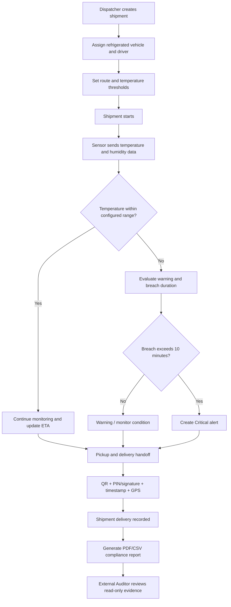
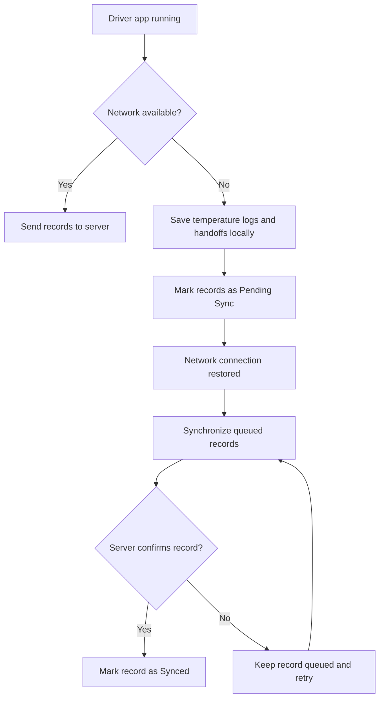
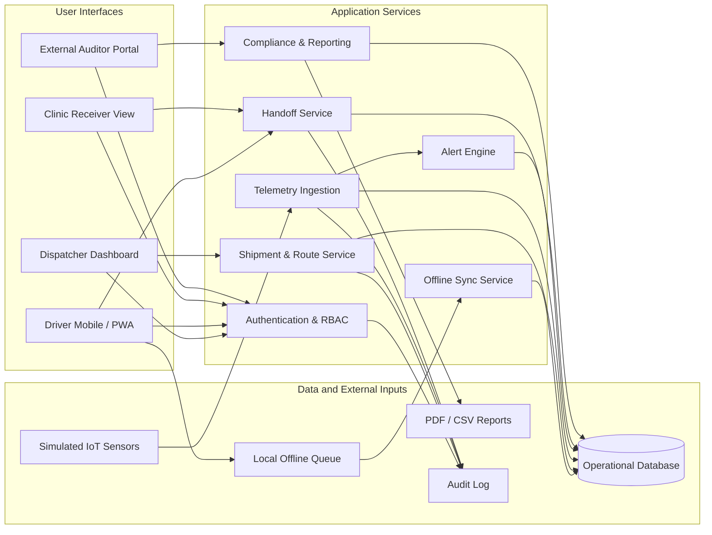
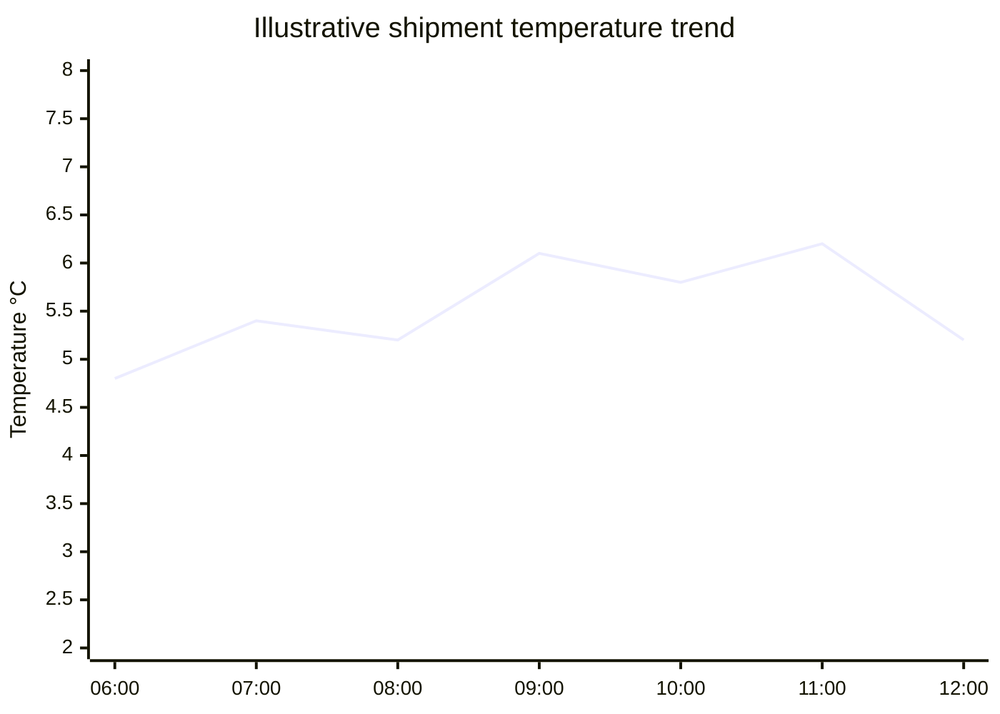

# ColdChain Pulse

### Pharmaceutical & Vaccine Cold-Chain Tracking Platform

**Precision in Every Degree. Confidence at Every Handoff.**

  
  
  
  

  <strong>Client:</strong> MedSwift Logistics Ltd. &nbsp; | &nbsp;
  <strong>Company Simulation:</strong> 41_B1 (Non Major)

---

## Live Operations Dashboard

  

  <em>Animated concept preview of shipment visibility, alert monitoring, temperature telemetry and delivery performance.</em>

> **Project status:** The client brief defines the MVP scope and expected behaviour. This README separates stated requirements from implementation details that must be confirmed in the source code. The current public repository snapshot contains the initial README and licence; the implementation stack and run commands should be added when the source files are committed.

---

## Table of Contents

- [1. Project Overview](#1-project-overview)
- [2. Business Problem](#2-business-problem)
- [3. Project Goals](#3-project-goals)
- [4. Core Features](#4-core-features)
- [5. User Roles and Access Control](#5-user-roles-and-access-control)
- [6. System Workflow](#6-system-workflow)
- [7. Conceptual Architecture](#7-conceptual-architecture)
- [8. Business Rules and Data Integrity](#8-business-rules-and-data-integrity)
- [9. Dashboard and Analytics](#9-dashboard-and-analytics)
- [10. Non-Functional Requirements](#10-non-functional-requirements)
- [11. QA and Testing Strategy](#11-qa-and-testing-strategy)
- [12. Technology and Deployment](#12-technology-and-deployment)
- [13. Team Structure](#13-team-structure)
- [14. Evaluation Criteria](#14-evaluation-criteria)
- [15. Project Resources](#15-project-resources)
- [16. Setup and Contribution Notes](#16-setup-and-contribution-notes)
- [17. Scope Notes to Confirm](#17-scope-notes-to-confirm)

---

## 1. Project Overview

**ColdChain Pulse** is a web and mobile-friendly pharmaceutical cold-chain tracking platform designed for the transportation of temperature-sensitive biologics and vaccines.

The platform gives logistics teams a shared operational view of shipments from dispatch to clinic delivery. It combines shipment and route management, simulated IoT telemetry, temperature-excursion alerts, digital chain-of-custody handoffs, offline-first driver workflows and compliance reporting.

The project is defined for **MedSwift Logistics Ltd.** as a Software Engineering Design Capstone MVP.

| Project detail | Description |
|---|---|
| Project name | ColdChain Pulse |
| Project domain | Pharmaceutical and vaccine logistics |
| Client | MedSwift Logistics Ltd. |
| Company simulation | 41_B1 (Non Major) |
| Delivery target | 1.5-hour Capstone project-class sprint (MVP) |
| Main platform | Web and mobile-friendly experience |
| Main operational goal | Protect shipment quality and provide traceable delivery evidence |

## 2. Business Problem

MedSwift Logistics transports temperature-sensitive biologics and vaccines from central warehouses to rural clinics. The client brief identifies several weaknesses in the current process:

- Drivers record temperatures on paper.
- Temperature problems may only be discovered when a shipment reaches its destination.
- Shipment handoffs need a traceable digital record.
- Rural routes may lose cellular coverage.
- Compliance teams need reliable temperature, handoff and SLA-breach reports.

These gaps can lead to delayed issue detection, incomplete shipment histories and weak delivery traceability.

### Proposed Solution

ColdChain Pulse provides a connected workflow in which shipment details, vehicle assignments, temperature readings, alerts and handoff events are linked to the same shipment record.

**Expected value:** earlier visibility of temperature excursions, more reliable chain-of-custody evidence, safer offline operation and faster compliance reporting.

## 3. Project Goals

1. Centralise shipment dispatch and route information.
2. Monitor simulated temperature and humidity readings at regular intervals.
3. Identify temperature warnings and prolonged critical excursions.
4. Record pickup and delivery handoffs with QR verification and PIN/signature evidence.
5. Allow drivers to save logs and handoffs while offline and synchronize them later.
6. Generate tamper-evident PDF and CSV compliance reports.
7. Enforce role-specific access and preserve append-only operational records.
8. Keep the dashboard usable with 500+ simulated active shipments.

## 4. Core Features

### 4.1 Dispatch and Route Management

Dispatchers need to create shipments, assign refrigerated vehicles and drivers, set safe temperature thresholds and monitor estimated arrival times.

**Key capabilities**

- Create and view shipment records.
- Generate and display shipment identifiers.
- Assign refrigerated vehicles and drivers.
- Store pickup and delivery locations.
- Configure shipment temperature limits.
- Track shipment status and live ETA.
- Search and filter shipment records.

### 4.2 Telemetry and Temperature Monitoring

The platform ingests simulated IoT sensor readings for active shipments.

**Key capabilities**

- Receive temperature and humidity readings.
- Process sensor data on the configured 30-second interval.
- Display current readings and temperature history.
- Calculate minimum, maximum and average temperature values.
- Associate every reading with its shipment and timestamp.
- Handle invalid, missing or delayed sensor data.

### 4.3 Temperature Excursion and Alert Management

The alert engine evaluates incoming readings against the configured shipment temperature range.

**Key capabilities**

- Identify normal, warning and critical conditions.
- Notify dispatchers and assigned drivers.
- Track breach duration and alert timestamps.
- Maintain an alert history.
- Escalate a sustained excursion to Critical according to the brief.

The example safe range in the client brief is **2°C to 8°C**. A Critical alert is required when a temperature breach continues for **more than 10 minutes**. The exact Warning threshold is not defined in the brief and must be confirmed with the product owner.

### 4.4 Chain-of-Custody Handoff

Pickup and clinic delivery require a digital handoff process.

**Key capabilities**

- Start pickup and delivery handoffs.
- Verify a shipment through QR code scanning.
- Verify handoff with PIN and/or digital signature.
- Capture the date and time of each event.
- Record GPS coordinates and condition status.
- Preserve the handoff history as an append-only record.

### 4.5 Offline-First Driver Mode

The driver experience must support routes with limited or no cellular coverage.

**Key capabilities**

- Detect and show offline status.
- Store temperature logs locally.
- Queue eligible pickup and delivery handoffs.
- Preserve pending records through refresh or app restart, subject to the selected storage design.
- Automatically synchronize queued records when connectivity returns.
- Prevent duplicate synchronization and retain original timestamps.

### 4.6 Compliance and Audit Portal

The compliance portal provides shipment and batch evidence for authorised users.

**Key capabilities**

- Generate shipment and batch reports.
- Include complete temperature history.
- Include pickup and delivery handoff records.
- Include SLA breach information.
- Export reports in PDF and CSV formats.
- Provide read-only access to External Auditors.
- Preserve traceability between the report and source records.

### 4.7 Operations Dashboard and Shipment Tracking

The dashboard brings the main operational indicators together.

**Dashboard areas**

- Active shipments and delivered-today KPIs.
- Temperature warnings and critical excursions.
- Active vehicle count and utilisation.
- Live shipment map and GPS update status.
- Live alert feed with severity and shipment context.
- Fleet temperature monitoring chart.
- Delivery performance and on-time percentage.
- Active shipment table with destination, vehicle, driver, temperature, ETA and status.
- Recent chain-of-custody events.

---

## 5. User Roles and Access Control

The client brief requires distinct permissions for five roles.

| Role | Main responsibility | Access principle |
|---|---|---|
| Admin | Platform and user administration | Administrative permissions according to the RBAC policy |
| Dispatcher | Shipment dispatch, vehicle/driver assignment and monitoring | Operational access to dispatch and monitoring functions |
| Driver | Assigned shipment execution, temperature logs and handoffs | Access limited to assigned work and driver functions |
| Clinic Receiver | Receive shipment and confirm clinic delivery | Access to authorised delivery and handoff functions |
| External Auditor | Inspect compliance evidence | **Read-only** access |

> The brief requires role separation but does not provide a full permission matrix for every screen and API. The final allow/deny matrix should be approved before security testing.

## 6. System Workflow

### 6.1 End-to-End Shipment Lifecycle

### 6.2 Offline Driver Synchronization

## 7. Conceptual Architecture

The following diagram represents the logical components required by the client brief. It is **not a claim about the current code structure or selected technology stack**.

### Conceptual Data Entities

The requirements imply the need for records representing:

- **User and Role** — account identity and permission assignment.
- **Shipment** — product/batch reference, route, status and temperature limits.
- **Vehicle and Driver Assignment** — refrigerated vehicle and responsible driver.
- **Telemetry Reading** — sensor identity, temperature, humidity and timestamp.
- **Alert / Excursion** — severity, breach duration, shipment and notification state.
- **Handoff Event** — pickup/delivery type, QR/PIN/signature evidence, GPS, timestamp and condition.
- **Compliance Report** — selected shipment or batch, reporting period and output format.
- **Audit Event** — actor, action and timestamp for traceability.

These are conceptual entities inferred from the required workflow; the approved database schema must be taken from the actual implementation.

## 8. Business Rules and Data Integrity

| Rule | Expected behaviour |
|---|---|
| Example safe temperature range | 2°C–8°C, configurable per shipment |
| Sensor update interval | Every 30 seconds, as specified in the brief |
| Temperature boundary | Values at 2°C and 8°C are within the example range |
| Out-of-range reading | Below 2°C or above 8°C is outside the example range |
| Critical excursion | Breach continues for more than 10 minutes |
| Warning threshold | Must be confirmed; not numerically specified |
| Temperature logs | Append-only; no silent edits or deletions |
| Handoff records | Append-only; no silent edits or deletions |
| Offline records | Must remain queued until synchronization is confirmed |
| Auditor permissions | Read-only |

### Auditability

Operational evidence should remain traceable to its source shipment. A report should not silently replace or alter historical sensor and handoff records. Corrections, if supported by the implementation, should preserve the original event and record the correcting action.

---

## 9. Dashboard and Analytics

The dashboard is intended to help dispatchers identify shipment risks quickly.

### Operational KPI Definitions

| KPI | Meaning |
|---|---|
| Active shipments | Shipments currently in an active workflow state |
| Delivered today | Shipments delivered during the selected day |
| Temperature warnings | Active warning-level temperature conditions |
| Critical excursions | Active critical temperature excursions |
| Active vehicles | Vehicles currently marked as active |
| Vehicle utilisation | Active vehicles divided by total available vehicles |
| On-time delivery rate | On-time deliveries divided by total delivered deliveries |

### Example Delivery Performance Calculation

The UI reference shows 81 on-time deliveries and 3 delayed deliveries out of 84 total deliveries.

\[
\text{On-time Rate} = \frac{81}{84} \times 100 \approx 96.4\%
\]

The figures above are **illustrative values from the supplied dashboard design**, not live production statistics.

### Temperature Trend

The production chart should use actual timestamped readings and clearly show the configured minimum and maximum limits.

---

## 10. Non-Functional Requirements

| Area | Requirement from the brief |
|---|---|
| Performance | Dashboard must handle 500+ concurrent simulated active shipments without UI lag |
| Security | Encrypted API communication |
| Password storage | Hashed credentials |
| Audit logging | Failed login attempts must be logged |
| Data integrity | Temperature logs and handoff records must be append-only |
| Access control | Separate permissions for Admin, Dispatcher, Driver, Clinic Receiver and External Auditor |
| Offline capability | Queue driver logs and handoffs locally and auto-sync when connectivity returns |
| Reporting | Tamper-evident PDF and CSV batch reports |

Performance acceptance should be demonstrated through a documented load test. The brief does not state a numeric API response-time SLA, so that target should be agreed separately rather than invented.

## 11. QA and Testing Strategy

Quality assurance covers both user-facing functionality and backend enforcement.

### Test Design Approach

- Positive and negative scenarios.
- Required-field and data validation.
- Boundary-value testing for temperature and breach duration.
- Role and permission testing.
- Offline and synchronization testing.
- API and data-integrity testing.
- Security testing, including authorised SQL injection and XSS checks.
- Performance and cross-module integration testing.

### Module-wise QA Coverage

The complete QA workbook contains **326 test cases and 326 matching test-data records** across the ten modules below.

| Module | Test cases |
|---|---:|
| Authentication & RBAC (including Registration) | 31 |
| Dispatch & Shipment Management | 30 |
| Telemetry & Temperature Monitoring | 30 |
| Temperature Excursion & Alert Management | 30 |
| Chain-of-Custody Handoff | 30 |
| Offline-First Driver Mode | 30 |
| Compliance & Audit Portal | 30 |
| Dashboard & Shipment Tracking | 55 |
| Data Integrity & Security | 30 |
| Performance & System Integration | 30 |
| **Total** | **326** |

### QA Execution Fields

Each test case is documented with:

`Test Case ID` · `Prerequisite` · `Title/Description` · `Step` · `Test Data` · `Expected Result` · `Actual Result` · `Priority` · `Pass/Fail` · `Comment` · `Executed By`

Priority and Pass/Fail are maintained as selectable dropdown fields in the Excel workbook.

  

---

## 12. Technology and Deployment

The supplied client brief defines the product capabilities and deployment guidance, but it does **not** specify a confirmed programming language, frontend framework, backend framework or database.

| Component | Status |
|---|---|
| Frontend framework | To be confirmed from the source implementation |
| Backend framework | To be confirmed from the source implementation |
| Database | To be confirmed from the source implementation |
| Telemetry source | Simulated IoT sensor data is required |
| Reporting | PDF and CSV output is required |
| Deployment guidance | The brief suggests Vercel, Streamlit or a similar platform |

> Update this section with the exact technologies, versions, environment variables and deployment URL once they are confirmed in the repository. Do not publish credentials, API keys or private environment files.

### Setup and Run

The public repository snapshot currently does not expose application source files or a dependency manifest. For that reason, exact installation and run commands cannot yet be stated reliably.

Once the implementation is committed, add:

1. Prerequisites and supported runtime versions.
2. Installation command.
3. Environment variable names (never secret values).
4. Database setup and migration steps.
5. Development server command.
6. Test execution command.
7. Deployment URL and release instructions.

---

## 13. Team Structure

The client brief describes a 25-student agency simulation.

| Department | Students | Responsibility |
|---|---:|---|
| Product & Project Management | 3 | Backlog, user stories, sprint planning and client communication |
| UI/UX Design | 2 | Wireframes, design system and driver-first workflows |
| Frontend Engineering | 6 | Dispatcher dashboard, audit portal and Driver PWA |
| Backend & Data Engineering | 7 | APIs, RBAC, database and telemetry simulator |
| QA, DevOps & Security | 7 | CI/CD, automated and load testing, security verification |
| **Total** | **25** | |

## 14. Evaluation Criteria

The brief states that the final grade is split between shared company success and individual contribution.

- **40% Shared Company Grade** — MVP demo, system integration and overall stability.
- **60% Role-Specific & Individual Grade** — role performance, Git commit history, Jira/Trello tickets and bi-weekly peer reviews.

### Role-Specific Rubric

| Department | Evaluation area | Weight |
|---|---|---:|
| Product & Project Management | Backlog & Requirements | 30% |
| | Scope & Change Management | 40% |
| | Sprint Ceremonies & Tracking | 30% |
| UI/UX Design | Driver Mobile-First Flow | 35% |
| | Dispatcher Dashboard UX | 35% |
| | Design System & Handoff | 30% |
| Frontend Engineering | Offline-First Driver PWA | 35% |
| | Dashboard Performance | 30% |
| | API Integration & Code Quality | 35% |
| Backend & Data Engineering | Schema & Migrations | 30% |
| | Telemetry & Alert Engine | 35% |
| | Security & Data Integrity | 35% |
| QA, DevOps & Security | CI/CD & Deployment | 30% |
| | Automated & Load Testing | 40% |
| | Security & Audit Verification | 30% |

---

## 15. Project Resources

| Resource | Link |
|---|---|
| GitHub Repository | [Pharmaceutical-Vaccine-Cold-Chain-Tracking-Platform](https://github.com/oynndri/Pharmaceutical-Vaccine-Cold-Chain-Tracking-Platform) |
| UX/UI Design Prototype | [Open Figma Site](https://alone-tan-83805626.figma.site/) |
| Complete QA Test Suite | [Download Excel Workbook](docs/ColdChain_Pulse_Complete_QA_Test_Suite.xlsx) |

### Repository

### UX/UI Prototype

### QA Documentation

---

## 16. Setup and Contribution Notes

Before a change is considered ready for review:

- Link the work to a requirement, issue or test case.
- Keep role restrictions enforced on the backend, not only hidden in the UI.
- Preserve append-only temperature and handoff records.
- Include loading, error, empty and offline states in the UI.
- Add or update tests when changing business rules.
- Do not commit credentials, access tokens or private customer data.
- Record evidence for failed tests and security findings.
- Run the appropriate regression tests before merging.

### Suggested Pull Request Checklist

- [ ] Requirement and acceptance criteria are clear.
- [ ] Relevant test cases have been executed.
- [ ] Priority and Pass/Fail results are updated.
- [ ] API permissions have been checked where relevant.
- [ ] No secret or private data is committed.
- [ ] Documentation has been updated.

---

## 17. Scope Notes to Confirm

The following items should be confirmed with the instructor/client before final acceptance:

1. **Warning threshold:** The brief requires Warning alerts but does not define the exact numeric warning boundary.
2. **Role permissions:** The brief lists five roles but does not include a complete screen/API permission matrix.
3. **API performance target:** The 500+ active shipment target is stated, but a numeric response-time SLA is not.
4. **Technology stack:** Exact frontend, backend and database technologies are not specified in the brief.
5. **QA team size discrepancy:** The department allocation section lists 7 QA/DevOps/Security students, while the role-specific rubric heading says 2–3 students. Confirm the intended allocation with the instructor.
6. **Deployment target:** The brief suggests Vercel, Streamlit or a similar platform; the final platform should be recorded after deployment.

---

**ColdChain Pulse**

*Precision in Every Degree.*

**A Software Engineering Design Capstone Project**

MedSwift Logistics Ltd. · 41_B1 (Non Major)

